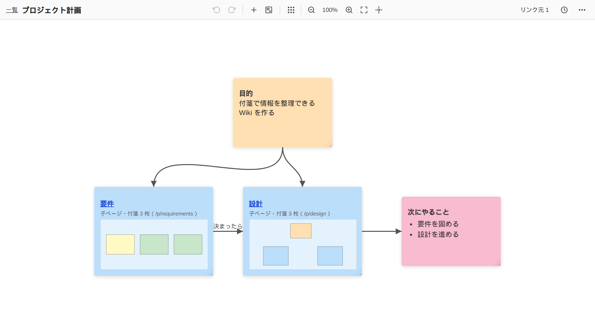

# wema-kake

[](LICENSE)
[](https://github.com/kan/wema-kake/commits/main)
[](https://www.npmjs.com/package/@kanf/wema)
[](https://developers.cloudflare.com/workers/)
[](https://www.typescriptlang.org/)
[](https://modelcontextprotocol.io/)

付箋を並べて書く Wiki です。1 ページが 1 枚のボードで、付箋を置き、線でつなぎ、ページの中に子ページを置いて整理します。Cloudflare Workers で動き、Claude などの LLM からも MCP で読み書きできます。



**wema-kake はライブラリ（npm: `@kanf/wema-kake`）で、デプロイ物ではありません。** 使う人は、雛形から自分のリポジトリを作り、自分の Worker としてデプロイします。Wiki の処理と画面はパッケージにあり、手元に持つのは設定だけです。更新は `npm update` とデプロイで済みます。
## 始め方

```sh
npx @kanf/wema-kake init my-wiki
cd my-wiki
npm run dev
```

`init` は、ディレクトリ、サイトの名前、既定の言語を聞いて、雛形を書き出します。`http://localhost:8787/` で開けます。

雛形から GitHub のリポジトリを作ってデプロイするなら、Deploy to Cloudflare のボタンも使えます。

[](https://deploy.workers.cloudflare.com/?url=https://github.com/kan/wema-kake/tree/main/template)

デプロイと、Cloudflare Access の設定の手順は、雛形の [README](template/README.md) にあります。**デプロイしただけでは、まだ使えません。** Access を設定するまで、画面と API は 500 を返します（保護のない状態で公開しないためです）。

### 手元に持つもの

| ファイル | 中身 |
| --- | --- |
| `src/config.ts` | サイトの名前、既定の言語、MCP を有効にするか、最初のページを作るか |
| `wrangler.jsonc` | Worker の名前、バインディング、デプロイ先ごとの値（Access の設定、サイトのオリジン） |
| `src/index.ts` | Worker の入口。設定を `@kanf/wema-kake` に渡すだけ |

```ts
// src/index.ts
import { createWemaKake, PageDO } from '@kanf/wema-kake';
import config from './config';

export { PageDO };
export default createWemaKake(config);
```

D1 のマイグレーションと画面は、`wrangler.jsonc` がパッケージの中（`node_modules/@kanf/wema-kake`）を直接指します。コピーしないので、更新で取り残されません。

### 更新

```sh
npm update @kanf/wema-kake
npm run deploy
```

`npm run deploy` は、D1 のマイグレーションを当ててから Worker をデプロイします。何を破壊的変更と呼び、版をまたいでデータをどう引き継ぐかは、[docs/package.md](docs/package.md) に書いてあります。

## できること

- 付箋を置く、動かす、色を付ける、線でつなぐ。箇条書き、チェックリスト、画像、リンクを書ける
- 複数のブラウザで同じページを開くと、変更がその場で反映される
- ページの中に子ページを置ける。子ページは、中の付箋の配置を縮小した図つきの付箋として表示され、押すとズームして入る
- ページの一覧もボードで、ページが付箋、ページ間のリンクが線になる。全文検索で絞り込める
- リモート MCP サーバーを備えていて、claude.ai のコネクタとして登録できる。LLM がボードを読み、付箋を足し、整理する
- LLM の操作は、操作の単位で記録される。ページの画面から、まとめて取り消せる

## wema との関係

名前は、神社で絵馬を掛ける場所「絵馬掛（えまかけ）」から来ています。wema が絵馬、wema-kake がそれを掛ける場所です。

ボードの表示と編集は、付箋ボードのライブラリ [wema](https://github.com/kan/wema)（npm: [`@kanf/wema`](https://www.npmjs.com/package/@kanf/wema)）が受け持ちます。wema は、ブラウザの中だけで動くライブラリです。保存先や同期の仕組みは持ちません。

wema-kake は、wema に次のものを足して Wiki にしたものです。

| wema が受け持つ | wema-kake が足す |
| --- | --- |
| 付箋と接続線の表示と編集 | ページという単位と、ページ間のリンク、ページの階層 |
| Undo / Redo、パンとズーム | サーバーへの保存と、複数のブラウザの間の同期 |
| 変更の内容を表すデータ（デルタ） | 全文検索、画像の保存、認証 |
| | LLM 向けの MCP サーバーと、その操作の取り消し |

wema の側に要る機能は、wema へ依頼して入れてもらい、その版を取り込んでいます。使っている wema の版は、`package.json` の `dependencies` にあります。

## 構成

| 役割 | 使っているもの |
| --- | --- |
| サーバー | Cloudflare Workers + [Hono](https://hono.dev/) |
| ページの内容と同期 | Durable Objects（1 ページ = 1 オブジェクト、SQLite、WebSocket） |
| ページの一覧と全文検索 | D1 |
| 画像 | R2 |
| 認証 | Cloudflare Access |
| LLM との連携 | リモート MCP（認可は、Access の Managed OAuth） |

## このリポジトリでの開発

```sh
npm install
cp .dev.vars.example .dev.vars
npx wrangler d1 migrations apply DB --local
npm run dev
```

`http://localhost:8787/` で開けます。ローカルでは Access を通らず、`.dev.vars` の `DEV_USER_EMAIL` が利用者になります。リポジトリの中の利用側（`dev/`）が、ビルドせずに `src/` を使います。

| コマンド | 内容 |
| --- | --- |
| `npm run dev` | 画面をビルドして、ローカルのサーバーを起動する |
| `npm run dev:roji` | 同じサーバーを、[roji](https://github.com/kan/roji)（1.5.0 以降）を通して起動する。空いているポートを使い、`https://wema-kake.<roji のドメイン>` で開ける |
| `npm test` | テストを実行する（Workers のランタイムの上で動く） |
| `npm run lint` | 型チェック |
| `npm run build` | 配るものを作る。画面（`dist/web`）と Worker の側（`dist/lib`） |
| `npm pack` | パッケージを作る（`prepack` が `build` を回す） |

## 文書

- [docs/package.md](docs/package.md): パッケージの入口、設定、互換の決まり
- [AGENTS.md](AGENTS.md): 設計と、実装で守る決まり。コーディングエージェント向けの指示を兼ねる
- [docs/plan.md](docs/plan.md): 実装の計画と、フェーズごとの記録

## ライセンス

[ISC](LICENSE)
